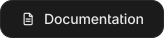
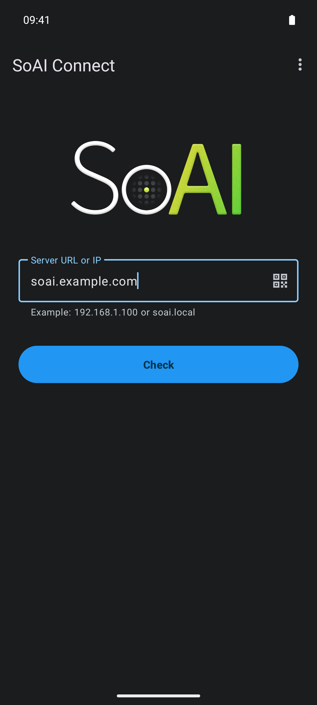

<p align="center">
<picture>
<source media="(prefers-color-scheme: dark)" srcset="media/readme/soai-wordmark-dark.webp">
<source media="(prefers-color-scheme: light)" srcset="media/readme/soai-wordmark-light.webp">

</picture>
</p>

<p align="center"><strong>SoAI Connect for Android</strong></p>

SoAI Connect is the official Android app for [SoAI](https://soai.to). It opens your server's WebUI for chat, models, files, and automations, with QR setup, native background notifications, and Wake-on-LAN.

<p align="center">
<a href="https://soai.to/download/android"></a>
<a href="https://soai.to/documentation/"></a>
</p>
<p align="center">
<a href="https://github.com/GetSoAI/SoAI_Connect"></a>


<a href="LICENSE.md"></a>
</p>

<p align="center">

</p>

## What SoAI Connect does

Connect to your server by scanning its QR code or entering a hostname or IP address. SoAI Connect identifies the server and its active port, reports fallback ports, and asks for an explicit endpoint when multiple instances answer. It supports HTTP and HTTPS, including custom and self-signed certificates that you explicitly approve.

The app delivers agent approval requests, questions, secret prompts, automation results, mail alerts, and calendar reminders to Android's notification shade. Notifications come directly from your server through a background connection, without a push provider or Google account.

Camera and microphone access use Android permission prompts, while uploads use Android's file picker. Wake-on-LAN can wake a compatible server before you connect. The interface follows your system's light or dark theme.

## Install SoAI Connect

You need Android 8.0 (API 26) or newer and a SoAI server reachable from your phone.

Download the APK and matching `.sha256` sidecar from Releases in the [SoAI Connect repository](https://github.com/GetSoAI/SoAI_Connect). The app is distributed by sideloading and has no app-store listing.

To update, install the new APK over the existing app with the same signing identity. Do not uninstall or clear application data, which removes your saved connection and settings.

<details>
<summary><strong>Verify the APK and signing certificate</strong></summary>

```sh
sha256sum -c SoAI-Connect-<version>-android.apk.sha256
apksigner verify --verbose --print-certs SoAI-Connect-<version>-android.apk
```

Official APKs use signature schemes v2 and v3, without a v1 JAR signature, and this signing identity:

```text
Signer: CN=SoAI Connect, O=SoAI, L=Rome, C=IT
SHA-256 digest: 664ee2c1ce55db7179eafab41ff22585380e236e1a8163a50e273e4691b6990b
```

Do not install the package if checksum or signature verification fails, or if its certificate fingerprint differs.

</details>

### First connection

1. In your server's WebUI, open **Settings → Connect** to display its QR code.
2. In SoAI Connect, tap the QR icon beside **Server URL or IP** and allow camera access.
3. Scan the code, review any connection or certificate prompt, and sign in with your SoAI account.

The phone must be able to reach the address in the QR code. The app verifies the server identity before connecting and asks you to review changed connection details. Scanning sets up the connection; it does not sign you in.

For a certificate that needs approval, compare its SHA-256 fingerprint with your server's certificate before choosing **Trust once** or **Trust always**. A saved pin is tied to the server address and identity, and a changed certificate requires approval again.

<details>
<summary><strong>Connect by address</strong></summary>

Enter a hostname, IPv4, or IPv6 address, such as `soai.example.com`, and tap **Check**. Add `:port` for an explicit endpoint, or use `http://` or `https://` to try that scheme first.

Review the discovered server and tap **Connect**, then sign in. Subsequent launches open your saved server. HTTP connections to public hosts display a cleartext warning.

</details>

## Notifications and device controls

Open **Settings → Privacy → Android Notifications** to enable native alerts and grant notification permission. Delivery depends on connectivity, Android notification channels, and battery restrictions. The app reports blocked permissions or channels and links to Android settings. Its background guidance dialog also opens battery settings; choose unrestricted battery use if your device requires it.

You can name the device in the same section to identify it in the server's session list.

Under **Settings → Power**, enter the server's MAC address and tap **Wake now**. You can configure the broadcast address and UDP port. Wake-on-LAN must be enabled in the server's firmware and operating system, and your network must allow the packet to reach it.

## Privacy and session management

SoAI Connect stores your server address, sign-in cookies, preferences, and WebUI cache on the device. Incognito Mode clears cookies, site data, cache, and temporary certificate trust when you leave the app. Saved server settings and persistent certificate pins remain.

The toolbar menu contains **Reload**, **Settings**, and **About**. **Settings → Data** provides **Clear Cache**, **Logout**, and **Change server**. Logout requests server-side session revocation; if it cannot confirm success, you can retry or explicitly clear only local credentials. Change server clears the saved connection and returns to setup.

Use **Settings → Security → Reset Trusted Certificate** to remove the saved pin without changing the server address.

## Build from source

Install JDK 17 and an Android SDK with platform 37 and suitable build tools. Set `sdk.dir` in `android/local.properties`, then run:

```sh
cd android
./gradlew :app:test :app:lint :app:assembleDebug
```

<details>
<summary><strong>Release signing, project layout, and versioning</strong></summary>

Debug builds need no signing material. For a signed build of your own fork, configure your own keystore in `android/local.properties`:

```properties
sdk.dir=/path/to/android-sdk
soai.release.storeFile=/path/to/your-release.keystore
soai.release.storePassword=...
soai.release.keyAlias=...
soai.release.keyPassword=...
```

Run `./gradlew :app:assembleRelease`. Release builds are refused without signing properties. Keep this file private and untracked, store the keystore outside the checkout, and back it up. In-place updates require the same signing key.

`android/` contains the Gradle project, with application sources under `android/app/src/main/kotlin/com/soai/android/`. Dependency notices are in `licenses/`.

`VERSION` controls the client version independently of the SoAI server and its automatic updater. Android's `versionCode` is derived as `major * 10000 + minor * 100 + patch`; minor and patch components must stay below 100.

</details>

## Licensing

SoAI Connect is licensed under the MIT License; see `LICENSE.md`. You may inspect, copy, modify, and redistribute it, including as the basis for your own client.

That grant covers this client only. It conveys no right in the SoAI name, logos, or product identity, and no right to run, copy, or distribute SoAI itself. Connecting a client to a SoAI deployment still requires rights applicable to that deployment. SoAI is distributed under the SoAI Source-Available License 1.0; see the downloads section of [soai.to](https://soai.to).

Third-party components retain their own licenses. `licenses/ANDROID-THIRD-PARTY-LICENSES.txt` lists dependencies and license texts, also available under **About → Licenses**. Dependency changes require updated notices and attribution records in `licenses/attributions/`.

## Security and support

Report bugs or request features through Issues in the [SoAI Connect repository](https://github.com/GetSoAI/SoAI_Connect). Include the client version, Android version, steps, and expected result.

Report security vulnerabilities privately as described in `SECURITY.md`. Pull requests are not accepted; see `CONTRIBUTING.md`.
